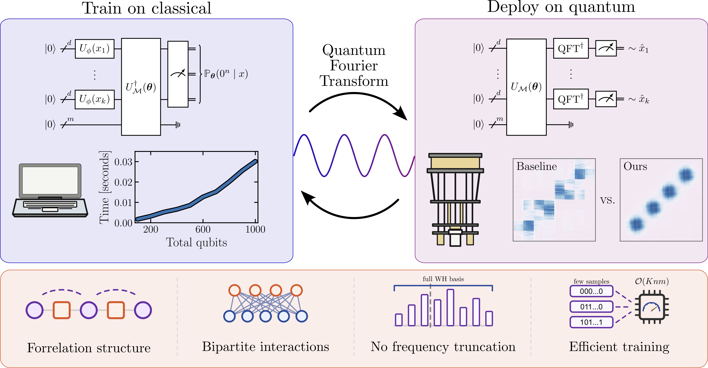

# Quantum Fourier Generative Models Trainable at Large Scale

Reference implementation for the paper
**"Quantum Fourier Generative Models Trainable at Large Scale"**.

<p align="center">
  <a href="https://arxiv.org/abs/2606.28483">
    
  </a>
  <a href="https://doi.org/10.6084/m9.figshare.32789952">
    
  </a>
</p>

<p align="center">
  
</p>

## Overview

We propose an algorithmic framework for building and training quantum generative
models corresponding to multivariate probability distributions. Our model uses
parallel Fourier feature maps for embedding continuous-valued variables combined
with a forrelation-type quantum circuit for tuning Fourier coefficients of the
quantum model. Crucially, we develop a distinct training strategy where training
is enabled at large scale by log-likelihood loss with unbiased Monte Carlo
estimator based on Parseval's identity. Unlike prior work that relied on maximal
mean discrepancy (MMD) loss, our approach goes beyond matching just low frequency
moments, while enabling efficient classical training. Once the model is trained,
we use inverse quantum Fourier transforms to map it into a separate sampling
circuit in the computational basis.

We demonstrate the efficiency of the suggested framework by validating loss
estimation at the scale of over 1000 qubits on a single GPU. We show that
univariate and bivariate models with highly non-trivial structure can be trained
to low total variation distance, while fine-tuned IQP models with MMD loss show
poor performance. Comparing to classical baselines represented by normalizing
flow and diffusion models, we show that our approach avoids oversmoothing and
preserves multi-modal structure of the target. Finally, we have deployed the
trained models on superconducting quantum devices, successfully sampling
distributions with per-sample execution times of approximately 300 μs. Our work
shows that quantum generative models with the train-on-classical
deploy-on-quantum approach can provide both high-quality structure at increased
scale and fast sampling access needed for inference.

This repository contains everything needed to train the DQGM model on simulated
hardware: the quantum circuit, the classical estimator that makes training
scalable, a handful of synthetic target distributions, and example notebooks
that reproduce the small-scale experiments from the paper. The full set of
results and trained models is archived on
[figshare](https://doi.org/10.6084/m9.figshare.32789952).

## Installation

```bash
conda env create -f environment.yml
conda activate dqgm
```

This pins the same versions the paper experiments were run with. The
`jax[cuda12]` wheel targets a Linux machine with an NVIDIA GPU; on CPU-only
machines or macOS, swap it for the plain `jax==0.8.2` line noted in
`environment.yml`. JAX selects the GPU automatically when one is visible and
falls back to CPU otherwise.

## Quick start

Train the 1D Gaussian model from the paper:

```bash
python scripts/train.py --config configs/exp1_gaussian.yaml
```

Each run writes a timestamped directory under the config's `save_dir`:

```
logs/exp1_gaussian/run_YYYY-MM-DD_HH-MM-SS-ffffff/
    config.yaml          copy of the config used for this run
    history.csv          loss, KL, TVD, and parameter/gradient norms per step
    params_step0.npz     initial parameters
    params_stepN.npz     checkpoint snapshots
    grads_stepN.npz      gradient snapshots
```

The two provided configs reproduce the small-scale experiments:

| Config | Target | Qubits |
|---|---|---|
| `configs/exp1_gaussian.yaml` | 1D Gaussian (Fourier encoding) | 17 visible + 4 hidden |
| `configs/exp2_blobs.yaml`    | 2D blobs (joint density)       | 18 visible + 4 hidden |

## Notebooks

The `notebooks/` directory walks through the model end to end:

- **`01_quickstart.ipynb`** — the circuit, the MC estimator, and how to
  load a trained checkpoint and sample from it.
- **`02_gaussian_1d.ipynb`** — train on the 1D Gaussian and plot the learned vs.
  target density together with the KL / TVD curves.
- **`03_blobs_2d.ipynb`** — train on the 2D blobs and visualise the learned
  joint distribution.

## Repository layout

```
dqgm/                python package
    model.py             DQGM circuit: qubit layout and gate connectivity
    classical_simulator.py  MC-based P(v=0|x) estimator used for training
    qiskit_simulator.py     exact statevector / sampling backend for evaluation
    trainer.py           mini-batch training loop
    dataset.py           synthetic target distributions and discretisation
    logger.py            history.csv, config, and checkpoint writer
    utils.py             metrics (KL/JSD/TVD) and helpers
scripts/train.py     config-driven training entry point
configs/             experiment configs
notebooks/           worked examples
```

## Citation

```bibtex
@misc{tuysuz2026,
      title={Quantum Fourier Generative Models Trainable at Large Scale}, 
      author={Cenk Tüysüz and Oleksandr Kyriienko and Michele Grossi},
      year={2026},
      eprint={2606.28483},
      archivePrefix={arXiv},
      primaryClass={quant-ph},
      url={https://arxiv.org/abs/2606.28483}, 
}
```
